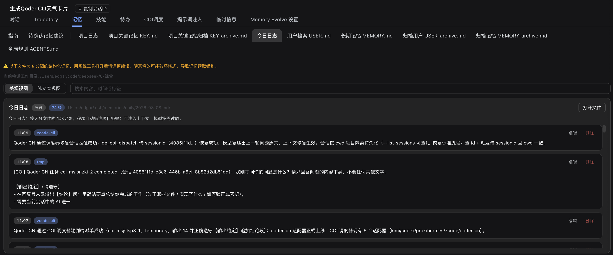
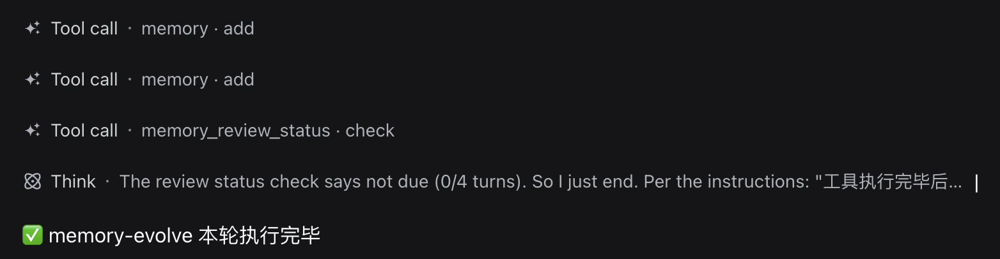
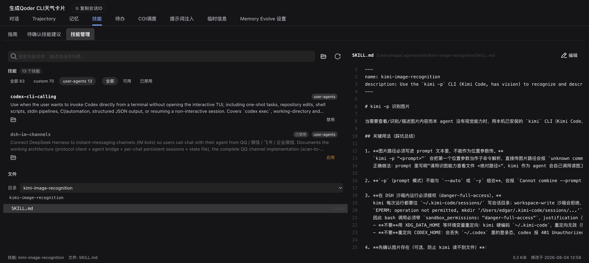
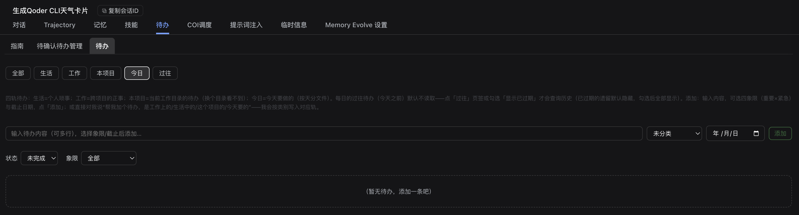
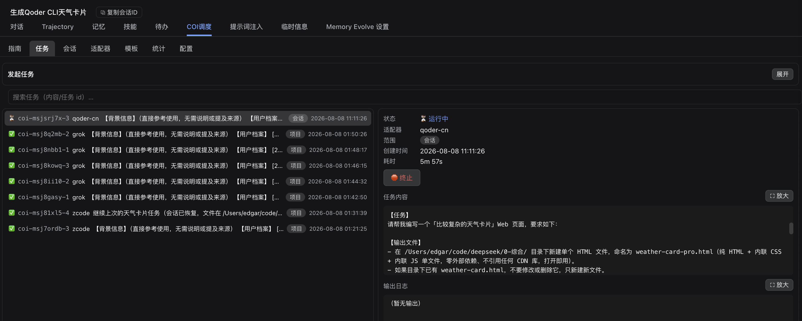
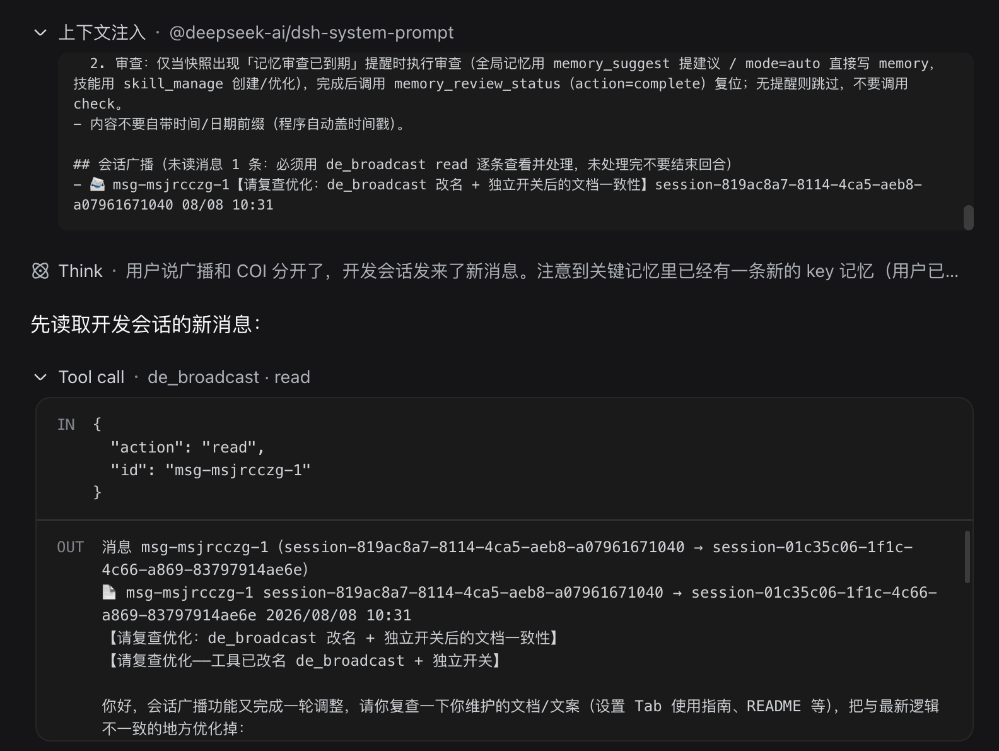
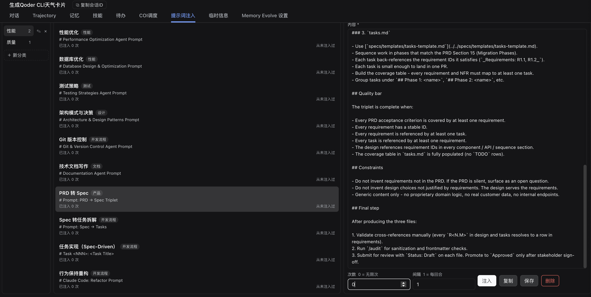

<div align="center">

# 🧬 dsh-memory-evolve

**Give the AI inside DSH a memory of you, a memory of the project, and a habit of getting better.**

Cross-session memory · self-evolving skills · todo management · multi-agent collaboration

**English** · [简体中文](./README.md) · [📖 Usage guide](./docs/USAGE.en.md) · [🔍 Detailed docs (中文)](./README-详细说明.md) · [📝 Changelog](./docs/CHANGELOG.en.md)

[](./LICENSE)
[](./package.json)
[](./tests)
[](https://github.com/deepseek-ai/dsh)



</div>

---

## Three real annoyances it fixes

| 😣 What you hit | ✅ What you get |
| --- | --- |
| Every new session the model meets you for the first time — decisions and preferences gone | **Layered long-term memory**: user profile, global facts, project key memory, project log, daily log — carried across sessions |
| You explain the same pitfall for the third time | **Self-evolution**: experience becomes reusable skills, browsable and exportable |
| Things you meant to do are buried in old chats | **Four-track todos**: project / work / life / daily, with Eisenhower quadrants, due dates and status flow |

Beyond that: **multi-agent dispatch** (external AI CLIs), **session broadcast** (message other DSH sessions), an **infinite canvas**, a **prompt library**, and **multi-machine memory sync**.

> 💡 Only the core memory features are on by default. Everything else is opt-in from **Memory Evolve Settings** — a disabled feature costs zero tool-list space.

---

## Features

<table>
<tr><td width="50%" valign="top">

### 🧠 Layered memory
Five separate layers (user profile / global facts / project key memory / project log / daily log). Project memory can be **scoped to a git branch**; over-budget entries degrade to index lines instead of being deleted.



</td><td width="50%" valign="top">

### 🌱 Self-evolution
Distil experience from real conversations into reusable skills — browse, edit, export.



</td></tr>
<tr><td valign="top">

### ✅ Four-track todos
Independent project / work / life / daily tracks, quadrants, due dates, status flow.



</td><td valign="top">

### 🤝 COI dispatch
Hand tasks to kimi / codex / grok / hermes and other external AI CLIs, with progress visibility.



</td></tr>
<tr><td valign="top">

### 📡 Session broadcast
Message other DSH sessions — rooms, presence, image attachments.



</td><td valign="top">

### 🎨 Canvas / Prompt library
Pin files, text, images and media onto a pannable board; manage prompts and inject them per scenario.



</td></tr>
</table>

Full screenshots and walkthroughs: [usage guide](./docs/USAGE.en.md).

---

## Install

```sh
# Option 1: straight from GitHub (recommended)
dsh plugin --profile web add github:xiaohuo130/dsh-memory-evolve

# Option 2: local development
git clone https://github.com/xiaohuo130/dsh-memory-evolve
dsh plugin --profile web add ./dsh-memory-evolve
```

> 📌 Bundles are assembled at **DSH startup**: install → **restart DSH** → **refresh the page**.
>
> ⚠️ Use the standard install path above. Do **not** hand-edit the profile's `package.json` or `cordis.patch.yml` — upgrades and uninstalls will break.

---

## Quick start

1. Open any session — extra tabs appear: **Memory / Skills / Todos / COI / Broadcast / Canvas / Prompts / Sync**;
2. Open **Memory Evolve Settings** and enable what you need;
3. Just chat — progress is written to the project and daily logs every turn;
4. To persist a decision, say "**remember: ...**". It asks for confirmation before writing project key memory;
5. To review or clean up, open the **Memory** tab and filter by date or keyword.

Full workflow (what each tab does, when to archive): [usage guide](./docs/USAGE.en.md).

---

## FAQ

<details>
<summary><b>Won't it accumulate until the context blows up?</b></summary>

No. Memory has five layers and only *user profile / global facts / project key memory* are injected automatically. Beyond the budget (default 20000 characters) older entries degrade to one-line index entries — the body is not deleted, just retrieved on demand.
</details>

<details>
<summary><b>How do I make it forget something completely?</b></summary>

Delete the entry in the **Memory** tab, or use the `memory` tool with `remove` / `archive`. Archived entries stop consuming injection budget but stay retrievable.
</details>

<details>
<summary><b>I switched machines — do I have to retrain it?</b></summary>

No. Turn on **Memory sync** and project memory travels over git, with conflict merging and identity isolation. See [memory sync](./docs/记忆同步.md).
</details>

<details>
<summary><b>Do I have to enable every feature?</b></summary>

No. Only basic memory is on by default. COI dispatch, session broadcast, session review, canvas and the like are individual switches in Settings — a disabled feature is not in the model's tool list.
</details>

---

## Build

`lib/client.js` is a **pre-built artefact** — installing does not require a build.

To change the web client:

```sh
# esbuild is resolved from a DSH source checkout
export DSH_SOURCE=/path/to/dsh-checkout
node scripts/build.mjs      # writes lib/client.js
```

The build script backs up the previous `lib/client.js` to `lib/client.js.bak-build-<timestamp>`.

---

## Test

```sh
node --test 'tests/*.test.js'   # Node >= 20
```

Covers memory storage, sync, session broadcast, COI dispatch, todos, skills, bookmarks, notifications and WebUI APIs.

> ✅ **Current status: 729 / 729 passing**, verified on Windows 11 (Node 22) and macOS.
> Path normalization, platform probes (`/Volumes`, `mdfind`) and git-backed scenarios all have dedicated cross-platform handling.

---

## Layout

```
.
├── lib/                 # host runtime + pre-built client bundle
├── src/client/          # web client sources (TS / TSX)
├── scripts/             # build and worker scripts
├── skills/              # bundled skill templates
├── tests/               # node:test suite
├── docs/                # guides, screenshots, changelog
├── vendor/              # mermaid engine (served on demand from /memory-evolve/mermaid/)
└── README.md
```

---

## Compatibility

| Item | Requirement |
| --- | --- |
| DSH | `tools` / `systemPrompt` / web client runtime (verified on 0.1.x and 0.2.x) |
| Node.js | ≥ 20 |
| Host runtime deps | none (pure ESM) |
| Frontend deps | bundled into `lib/client.js` |

---

## Docs

| Document | Contents |
| --- | --- |
| [Usage guide (English)](./docs/USAGE.en.md) | What each tab does, full workflow |
| [使用指南（中文）](./docs/使用指南.md) | Same, in Chinese |
| [Detailed docs (中文)](./README-详细说明.md) | Module-level design notes |
| [Memory sync](./docs/记忆同步.md) | Share project memory across machines |
| [COI dispatch](./docs/COI-调度.md) | External AI CLI orchestration |
| [Changelog](./docs/CHANGELOG.en.md) | Version history |

---

## Contributing

Issues and PRs are welcome. Before submitting:

- `node --test 'tests/*.test.js'` passes;
- when changing the frontend, commit both `src/` and the rebuilt `lib/client.js`.

---

## License

[MIT](./LICENSE) © 2026 xiaohuo130

<div align="center">

If it saves you from explaining the same thing twice, a ⭐ is appreciated.

</div>
