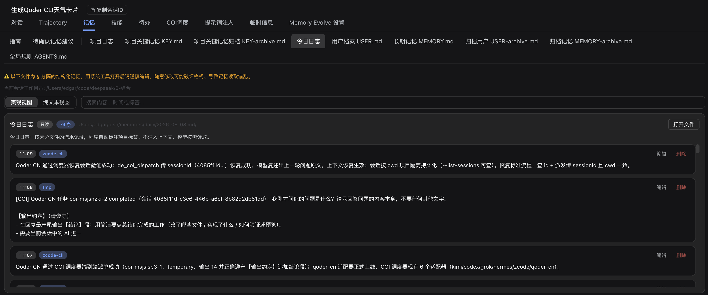
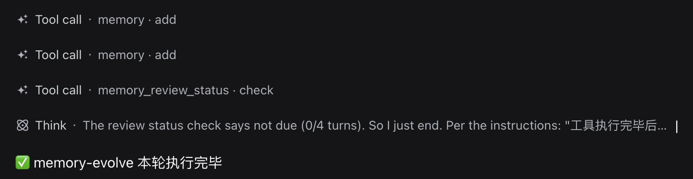
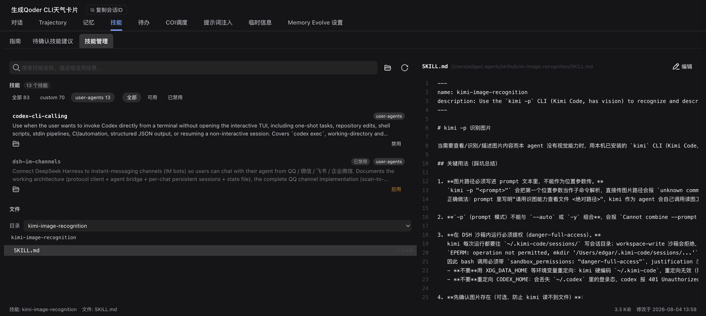
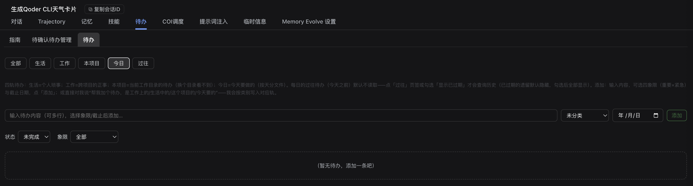
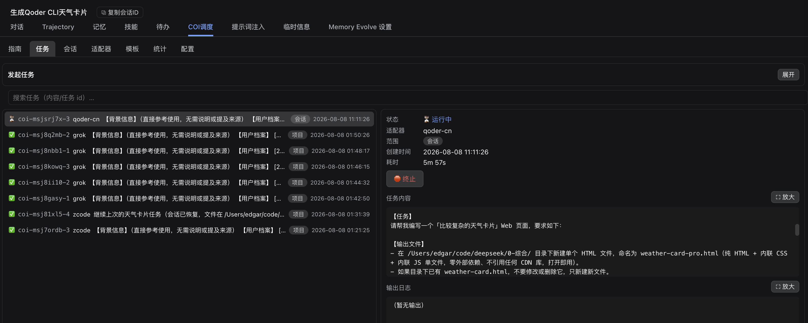
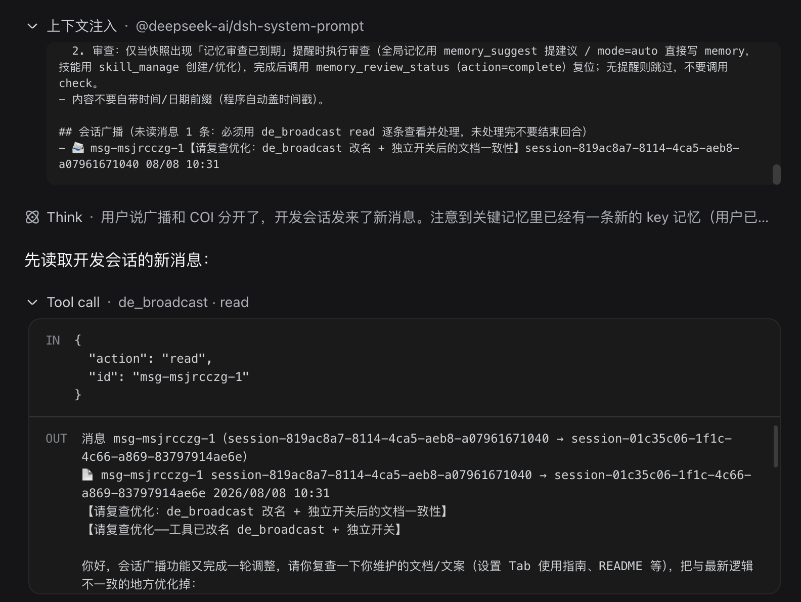
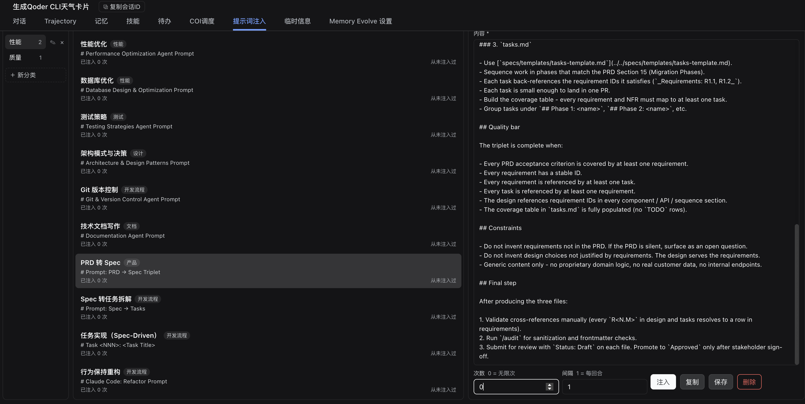

<div align="center">

# 🧬 dsh-memory-evolve

**让 DSH 里的 AI 记住你、记住项目、越用越顺手。**

跨会话记忆 · 自我进化技能 · 待办管理 · 多 Agent 协作

[简体中文](./README.md) · [English](./README.en.md) · [📖 使用指南](./docs/使用指南.md) · [🔍 详细功能说明](./README-详细说明.md) · [📝 更新日志](./docs/CHANGELOG.md)

[](./LICENSE)
[](./package.json)
[](./tests)
[](https://github.com/deepseek-ai/dsh)



</div>

---

## 它解决三个真实的麻烦

| 😣 你遇到的 | ✅ 它给你的 |
| --- | --- |
| 每次开新会话，AI 都像第一次见你——上次说过的话、定过的规矩全忘 | **分层长期记忆**：用户档案、全局事实、项目关键记忆、项目日志、每日日志，跨会话自动带上 |
| 同一个坑踩了三次，每次都得重新教它一遍 | **自我进化**：把经验沉淀成技能，下次自动生效，还能浏览、管理、导出 |
| 想到要做的事散落在聊天记录里，过两天就忘了 | **四轨待办**：项目 / 工作 / 生活 / 每日，支持四象限、截止日期、状态流转 |

除此之外还有：**多 Agent 协作**（调度外部 AI CLI）、**会话广播**（会话之间互发消息）、**无限画板**、**提示词库**、**多机记忆同步**。

> 💡 插件默认只开最基础的能力，其余在 **Memory Evolve 设置**里按需打开——不开的功能不会占用模型的工具清单。

---

## 功能一览

<table>
<tr><td width="50%" valign="top">

### 🧠 分层记忆
用户档案 / 全局事实 / 项目关键记忆 / 项目日志 / 每日日志五层分离。项目记忆可**按 git 分支生效**；超出注入预算时旧条目自动降级成目录行（不删，可回收）。



</td><td width="50%" valign="top">

### 🌱 自我进化
从真实会话里沉淀经验、生成可复用技能。技能可浏览、可编辑、可导出。



</td></tr>
<tr><td valign="top">

### ✅ 四轨待办
项目 / 工作 / 生活 / 每日四条独立轨道，四象限优先级、截止日期、状态流转。



</td><td valign="top">

### 🤝 COI 调度
把任务统一派给 kimi / codex / grok / hermes 等外部 AI CLI，进度可视化。



</td></tr>
<tr><td valign="top">

### 📡 会话广播
DSH 会话之间互发消息，支持房间、在线状态与图片附件。



</td><td valign="top">

### 🎨 无限画板 / 提示词库
文件、文本、图片、音视频集中到一块可平移缩放的画布；提示词按场景注入管理。



</td></tr>
</table>

完整截图与操作步骤见 [使用指南](./docs/使用指南.md)。

---

## 安装

```sh
# 方式一：直接从 GitHub 装（推荐）
dsh plugin --profile web add github:xiaohuo130/dsh-memory-evolve

# 方式二：本地开发
git clone https://github.com/xiaohuo130/dsh-memory-evolve
dsh plugin --profile web add ./dsh-memory-evolve
```

> 📌 插件在 **DSH 启动时**装配：装完 → **重启 DSH** → **刷新页面**。
>
> ⚠️ 请用上面的标准安装方式。**不要**手动改 profile 的 `package.json` 或 `cordis.patch.yml`，否则升级和卸载都会出问题。

---

## 快速开始

1. 打开任意会话，页面会多出 **记忆 / 技能 / 待办 / COI 调度 / 会话广播 / 画板 / 提示词 / 记忆同步** 等标签；
2. 进入 **Memory Evolve 设置**，按需打开对应能力；
3. 正常聊天就行——每回合结束会把进展写进项目日志与今日日志；
4. 想让它记住某个重要结论，直接说「**记一下：……**」，写入项目关键记忆前会先等你确认；
5. 想清理或回看历史，去 **记忆** 标签里按日期/关键词检索。

完整工作流（含每个标签怎么用、什么时候该归档）：[使用指南](./docs/使用指南.md)。

---

## 常见问题

<details>
<summary><b>会不会越记越多，把上下文撑爆？</b></summary>

不会。记忆分五层，只有「用户档案 / 全局事实 / 项目关键记忆」会自动注入；超出预算（默认 20000 字）时，旧条目自动降级为一行目录，正文不删除、需要时再查。
</details>

<details>
<summary><b>我想让它彻底忘掉某条怎么办？</b></summary>

在「记忆」标签里删除该条，或用 `memory` 工具的 `remove` / `archive`。归档不占注入预算，但内容保留，随时可以移回。
</details>

<details>
<summary><b>换电脑了，项目记忆还要重新教？</b></summary>

不用。开启「记忆同步」后，项目记忆通过 git 在多台机器间共享，带冲突合并与身份隔离。见 [记忆同步](./docs/记忆同步.md)。
</details>

<details>
<summary><b>必须装全部功能吗？</b></summary>

不。默认只开基础记忆；COI 调度、会话广播、会话评审、画板等都在设置里单独开关，不开就不占模型的工具清单。
</details>

---

## 构建

`lib/client.js` 是**预构建产物**，直接安装即可用，不需要自己构建。

需要改前端源码时：

```sh
# 构建依赖 DSH 源码 checkout 里的 esbuild
export DSH_SOURCE=/path/to/dsh-checkout
node scripts/build.mjs      # 产出 lib/client.js
```

构建脚本会自动把旧的 `lib/client.js` 备份为 `lib/client.js.bak-build-<时间戳>`。

---

## 测试

```sh
node --test 'tests/*.test.js'   # 需要 Node >= 20
```

覆盖记忆存储、同步、会话广播、COI 调度、待办、技能、书签、通知、WebUI API 等模块。

> ✅ **当前状态：729 / 729 全部通过**，在 Windows 11（Node 22）与 macOS 上均已验证。
> 跨平台相关的路径归一化、平台探测（`/Volumes`、`mdfind`）与依赖真实 git 仓库的场景都做过专门处理。

---

## 目录结构

```
.
├── lib/                 # Host 运行时 + 预构建的 client bundle
├── src/client/          # Web 客户端源码（TS / TSX）
├── scripts/             # 构建与 worker 脚本
├── skills/              # 插件自带的技能模板
├── tests/               # node:test 测试套件
├── docs/                # 使用指南、截图、更新日志
├── vendor/              # mermaid 渲染引擎（按需从 /memory-evolve/mermaid/ 提供）
└── README.md
```

---

## 兼容性

| 项目 | 要求 |
| --- | --- |
| DSH | 提供 `tools` / `systemPrompt` / Web 客户端运行时（0.1.x / 0.2.x 均验证过） |
| Node.js | ≥ 20 |
| Host 侧运行时依赖 | 无（纯 ESM） |
| 前端依赖 | 已打入 `lib/client.js` |

---

## 文档

| 文档 | 内容 |
| --- | --- |
| [使用指南](./docs/使用指南.md) | 每个标签怎么用、完整工作流 |
| [详细功能说明](./README-详细说明.md) | 模块级设计说明 |
| [记忆同步](./docs/记忆同步.md) | 多机共享项目记忆 |
| [COI 调度](./docs/COI-调度.md) | 外部 AI CLI 派单 |
| [更新日志](./docs/CHANGELOG.md) | 版本变更 |
| [Usage guide (English)](./docs/USAGE.en.md) | English documentation |

---

## 贡献

欢迎 issue 与 PR。提交前请确认：

- `node --test 'tests/*.test.js'` 全部通过；
- 改动前端时，同时提交 `src/` 与重新构建的 `lib/client.js`。

---

## 许可

[MIT](./LICENSE) © 2026 xiaohuo130

<div align="center">

如果它帮你省下了重复解释的时间，欢迎点个 ⭐

</div>
